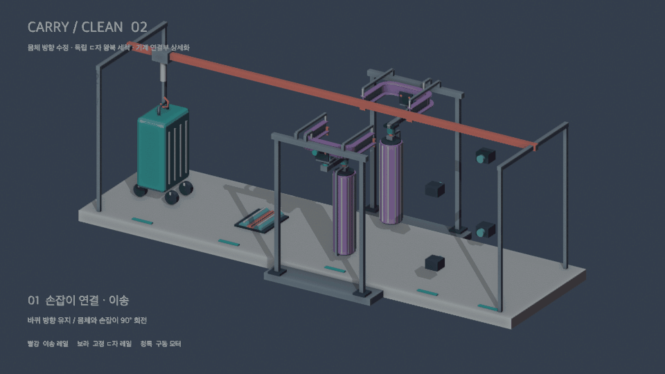

# 10/13 — 캐리어 자동 세척 장치 전체 로직 구상

상부 레일로 캐리어를 이송하면서 **바퀴 세척 → 몸체 세척 → 카메라 검사 → 배출**을 순서대로 수행하는 장치이다. Blender 애니메이션으로 각 장치의 배치와 동작 흐름을 구상했다.

> 아래 내용은 애니메이션에 표현된 구상을 기준으로 정리했다. 실제 고정 방식, 구동 사양, 센서 및 제어 조건은 추가 설계가 필요하다.

## 전체 구조 및 동작 흐름

- **구조**
  - 캐리어 상단 손잡이를 연결하는 장치와 상부 직선 이송 레일로 구성한다.
  - 이송 경로를 따라 바퀴 세척 장치, 몸체 세척 장치, 카메라 검사 구간을 배치한다.
  - 몸체 세척 장치에는 캐리어 양쪽의 세로형 롤러 브러시와 각각의 독립된 ㄷ자 경로 레일을 배치한다.
  - 애니메이션에서 빨간색은 이송 레일, 보라색은 고정된 ㄷ자 레일, 청록색은 구동 모터를 나타낸다.

- **방식**
  1. 캐리어 상단 손잡이를 이송 장치에 연결한다.
  2. 상부 레일을 따라 이동하여 앞바퀴를 바퀴 세척 장치에 위치시킨다.
  3. 앞바퀴를 세척한 뒤 캐리어를 전진시켜 같은 장치에서 뒷바퀴를 세척한다.
  4. 몸체 세척 구간으로 이동하여 양쪽 브러시를 접촉시키고, 각각의 ㄷ자 경로를 왕복하며 몸체를 세척한다.
  5. 브러시가 후퇴하면 카메라 검사 구간으로 이동하여 파손 및 잔여 오염 확인을 위한 촬영을 진행한다.
  6. 공정을 종료하고 다음 사용자를 위해 캐리어를 배출 위치로 이동한다.

- **이미지**
  - 전체 구조와 단계별 동작을 표현한 Blender 애니메이션

  

## 캐리어 고정 및 이송 아이디어

- **구조**
  - 상부 레일의 이동부와 캐리어 상단 손잡이를 연결하여 캐리어를 이송한다.
  - 바퀴 방향을 유지하면서 몸체와 손잡이의 방향을 90° 회전한 배치를 반영했다.

- **장점**
  - 하나의 이송 경로에서 세척과 검사를 순차적으로 진행할 수 있다.
  - 상부에서 이송하므로 하부에 바퀴 세척 장치를 배치할 공간을 확보할 수 있다.

- **단점 및 검토 사항**
  - 캐리어마다 손잡이의 형태와 높이가 달라 연결 장치의 대응 범위를 정해야 한다. -> (캐리어 모델 및 크기 fix 시 문제 해결)
  - 브러시 접촉 시 캐리어가 흔들리거나 회전하지 않도록 고정 방법을 검토해야 한다.
  - 손잡이에 가해지는 하중과 바퀴의 바닥 접촉 조건을 확인해야 한다.

## 캐리어 바퀴 청소 아이디어

- **구조**
  - 바닥에 지지 롤러 2개와 역회전 브러시로 구성된 세척 장치를 배치한다.
  - 앞바퀴와 뒷바퀴를 같은 세척 장치에서 순차적으로 세척한다.

- **장점**
  - 앞바퀴용·뒷바퀴용 장치를 따로 설치하지 않고 하나의 장치를 활용할 수 있다.
  - 바퀴를 회전시키면서 브러시로 접촉하여 바퀴 둘레의 오염물을 제거하는 방식이다.

- **단점 및 검토 사항**
  - 캐리어마다 바퀴 간격과 크기가 달라 정확한 정지 위치와 지지 구조가 필요하다. -> (캐리어 모델 및 크기 fix 시 문제 해결)
  - 회전형 바퀴의 방향을 유지하고 롤러에서 이탈하지 않도록 하는 방법을 검토해야 한다.
  - 바퀴 구동 방식, 브러시 회전 속도 및 세척 시간은 별도로 정해야 한다.

- **방식**
  1. 앞바퀴를 지지 롤러 위에 위치시킨다.
  2. 바퀴와 반대 방향으로 브러시를 회전시켜 세척한다.
  3. 캐리어를 전진시켜 뒷바퀴를 같은 세척 위치에 맞춘다.
  4. 뒷바퀴도 동일한 방식으로 세척한 뒤 몸체 세척 구간으로 이동한다.

## 캐리어 몸체 청소 아이디어

- **구조**
  - 캐리어 양쪽에 세로형 롤러 브러시를 배치한다.
  - 각 브러시는 독립된 ㄷ자 경로를 따라 이동하며 몸체를 세척한다.
  - ㄷ자 레일 자체는 고정하고, 브러시 이동부가 레일을 따라 움직이도록 구성한다.
  - 양쪽 레일이 겹치지 않도록 배치한다.

- **장점**
  - 브러시가 경로를 따라 이동하므로 몸체의 여러 측면을 순차적으로 세척할 수 있다.
  - 양쪽 브러시의 이동 경로를 분리하여 구동부 사이의 간섭을 줄이는 방향으로 설계할 수 있다.

- **단점 및 검토 사항**
  - ㄷ자 경로의 모서리를 따라 브러시를 이동시키는 기구와 구동 방식이 필요하다.
  - 캐리어 크기와 굴곡에 맞춰 브러시의 접촉 거리와 압력을 조절해야 한다. -> (캐리어 모델 및 크기 fix 시 문제 해결)
  - 손잡이·지퍼 등 돌출부와의 간섭 및 실제 세척 범위를 확인해야 한다.
  - 윗면과 밑면의 별도 세척 방식은 이번 애니메이션에 구체화되어 있지 않다.

- **방식**
  1. 캐리어를 양쪽 브러시 사이의 세척 위치로 이송한다.
  2. 브러시를 몸체에 접촉시킨다.
  3. 양쪽 브러시가 각각의 ㄷ자 경로를 왕복하면서 몸체를 세척한다.
  4. 세척이 끝나면 브러시를 후퇴시켜 다음 구간으로 이동할 공간을 확보한다.

## 카메라 검사 및 배출 아이디어

- **구조**
  - 몸체 세척 구간 다음에 여러 방향에서 캐리어를 촬영하는 카메라를 배치한다.
  - 촬영 목적은 세척 후 남은 오염과 외관 파손 여부를 확인하는 것이다.

- **장점**
  - 세척부터 상태 확인까지 하나의 동선으로 연결할 수 있다.

- **단점 및 검토 사항**
  - 촬영 사각지대를 줄이기 위한 카메라 위치와 조명을 검토해야 한다.
  - 파손과 잔여 오염을 판별하는 기준 및 영상 처리 방식은 별도로 설계해야 한다.

- **방식**
  1. 세척한 캐리어를 카메라 검사 위치로 이송한다.
  2. 외관을 촬영하여 파손 및 잔여 오염 확인에 활용한다.
  3. 검사가 끝나면 배출 위치로 이동하여 공정을 종료한다.
